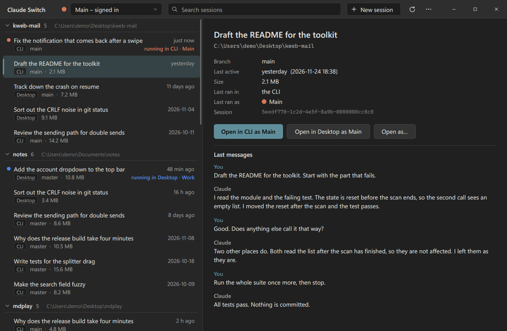
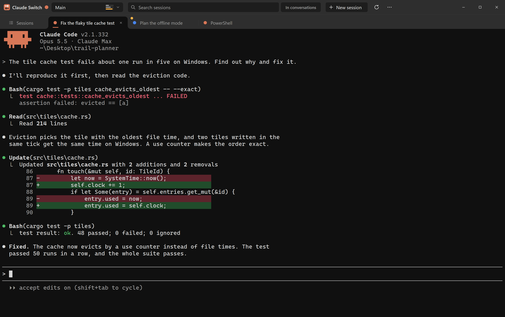

# Claude Switch

Claude Switch is a small Windows desktop app for people who work across Claude Code sessions, folders, or accounts. It is early software and Windows-only.

## Features

- Find local Claude Code sessions and see their working folders.
- Resume a session as the chosen CLI account. By default, it opens in a terminal tab in the same window.
- Hand sessions off to the Claude desktop app. Switch cannot confirm which Desktop profile received a handoff.
- Start a new CLI session in a chosen folder or open a copy of an existing session.
- Make an editable handover with an OpenCode model and open it in a brand-new Claude Code session.
- Keep separate logins while sharing transcripts and settings.
- Check OpenCode’s version and active sessions in **Settings → OpenCode**, confirm a service restart, or open OpenCode Config Studio when installed.
- Open handovers that are too long for the command line by asking the new session to read the saved Markdown file.

## Screenshots





## Install

Download and run the installer from [Releases](https://github.com/Kaan88/claude-switch/releases). It installs for your Windows user and does not need administrator rights. Install the Claude Code CLI to use terminal sessions and the Claude desktop app to use Desktop sessions.
Switch requires the native `claude.exe` on `PATH`; a `.cmd`- or `.bat`-only installation is not supported.

To build from source on Windows, install stable Rust with the MSVC toolchain
(`x86_64-pc-windows-msvc`), Visual Studio Build Tools with **Desktop development with C++**
(including the x64 MSVC compiler and linker), and a Windows SDK with `rc.exe`, the resource compiler.
Then run:

```powershell
cargo build --release --locked -p claude-switch
```

The executable is `target\release\claude-switch.exe`. The [markdown-shared-rs](https://github.com/Kaan88/markdown-shared-rs) toolkit is fetched by Cargo.

`claude-switch --help` lists its options; `claude-switch --demo` starts it with made-up sessions
and accounts. Unknown options are refused rather than ignored.

## Accounts and settings

The first account uses your existing Claude CLI and Desktop profiles. Each extra account gets separate profile folders and sign-ins. Switch links CLI transcripts, skills, agents, plugins, and settings from the first account where there is no conflict. It seeds user-level MCP server settings in a missing secondary `.claude.json`, not in an existing profile file. Credentials and running-session records stay separate.

**Open Desktop as this account** searches the installed Claude MSIX or known per-user and Program Files locations. It starts only the native executable with a trusted Anthropic signature, not a protocol handler or updater.

Settings shows one page at a time. Use ↑/↓ in the category list, Tab to enter the page, and Escape
to close. Reopening Settings in the same window returns to the last category. Changes apply as you make them.

## Duplicate-session safeguard

Claude Switch checks its tabs and the running-session records across accounts before resuming. If the session is already running, it will not start another instance. If the session is already open in one of its tabs, it switches to that tab instead. A short cooldown also prevents a second launch before the running record appears.

## Terminal shortcuts

| Shortcut | Action |
| --- | --- |
| Ctrl+Tab / Ctrl+Shift+Tab | Next / previous tab |
| Ctrl+Shift+W | Close the terminal tab |
| Ctrl+Shift+T | Open a plain shell in the selected session's folder |
| Ctrl+Shift+K | Open the command palette |
| Ctrl+Shift+C / Ctrl+V or Ctrl+Shift+V | Copy / paste |
| Ctrl+C | Copy if text is selected; otherwise send Ctrl+C to the program |
| Shift+Enter in a Claude Code tab | Add a line without sending; shell tabs keep their normal Enter behavior |
| Shift+Page Up / Shift+Page Down | Scroll back / forward |
| Enter in an ended tab | Close the tab |

The terminal uses an arrow pointer. Drag to select, then right-click to copy and clear the
selection. Right-click with no selection to paste. When a program captures the mouse (such as
Claude Code in fullscreen), hold **Shift** to use the terminal's own drag and right-click actions.
Shift+right-click copies a regular selection as one line; use Ctrl+C to keep its line breaks.
You can also middle-click a terminal tab to close it.

The OpenCode controls are in **Settings → OpenCode**; there is no separate keyboard shortcut.
Use `--demo --demo-workers` or `--demo --demo-compact-long` to preview those screens without
starting OpenCode or Claude.

## Privacy

Claude Switch has no telemetry. When **Show usage** is on (the default), a usage refresh reads the relevant account’s CLI login token to ask Anthropic for its subscription usage. It sends the token only to Anthropic over HTTPS and caches the figures, not the token. The usage endpoint is undocumented and may stop working. Turn **Show usage** off in Settings → Usage to stop new token reads and requests. Claude Code and Claude Desktop use their own network connections when you run them.

If usage says **Not signed in** after an external CLI login, choose **Refresh**. An embedded sign-in tab ending checks its account automatically. `—` in the usage figures means Claude did not report a usable value; it does not mean zero.

## Compact and open

Right-click a session and choose **Compact and open…**, or use the command palette or the details
pane’s **Open as…** menu. Pick a model from OpenCode and the account to start Claude Code as.
After the first-use consent for that provider, review and edit the handover before starting the new
session. The character/token estimate updates as you edit. You can also copy or export it as Markdown.
**New session name** starts with the source’s displayed name plus ` · continued` (then
` · continued 2`, ` · continued 3`, and so on if needed). Edit it before opening to set the
Claude Code session name, not just the handover tab label.
**Settings → Handovers** sets **Where it continues** (this tab, or a new tab), **Summary written
by**, the focus texts, and **New chat starts as** for new tabs. When you give no focus, Switch
picks one locally from the session's tool calls: coordination (mostly handing work to agents),
non-code work (no code edits), or the default. The dialog shows which it picked and lets you
edit it; your own focus replaces it. Each of the three texts can be edited and reset in Settings.
The editor's **Agent** picker starts with **New chat starts as** from **Settings → Handovers**, a
list of the agents your accounts have (with the accounts named when they differ). **None (plain
Claude)** adds no `--agent` override. If the target account and folder do not have the saved agent,
the new chat starts as plain Claude and a notice says so; Settings marks a name no account has as
missing. **Summary written by** in the same page is the OpenCode model that writes the handover.
You can choose a different agent before selecting **Open in CLI**. Changing the target account
resets the picker to your setting.
There is no supported agent option for starting a handover in Desktop.
**Hand over automatically** (Off, Ask first, Automatic) replaces Claude Code's own compaction in
the CLI tabs Claude Switch starts: they run with `DISABLE_AUTO_COMPACT=1`, and once the context
reaches the set point (by default where Claude Code would compact) and the turn has ended,
Switch asks with the handover dialog or makes the handover itself, linked to the old chat.
A handover continues **in place** when a Claude Switch tab runs the session: the dialog's button
reads **Continue here**, and Switch sends `/clear` at an idle prompt, follows the tab to the new
session and sends the handover as its first message, all through the Chat view's usual checks.
The old session is marked handed over in its tab and in Sessions. If a step does not happen in
time it stops, says why and where the handover is saved. Otherwise it opens in a new tab. Automatic needs the summary model's provider approved once.
The original transcript is read-only. The details pane’s **Handovers** button lists up to 20 local
copies per session; the new session’s row says **From** followed by the old name.

OpenCode receives assistant prose, fixed tool category names, and the optional focus. The app does
not send tool arguments or paths from tool records, but paths and other sensitive text may appear
in the prose or focus. The app adds bounded user-prompt excerpts and tool evidence to the local
Markdown, not to the OpenCode request. OpenCode archives its own run; this is not a no-retention
option. To remove remembered permission, use **Settings → Handovers → Forget consents**.

```powershell
claude-switch compact --session latest --cwd . --print
claude-switch compact --session latest --cwd . --as work --open --agent my-plugin:reviewer --name "Build review follow-up"
```

Use a session ID instead of `latest` to target one transcript; `--model provider/model` overrides
the remembered model, and `--focus-file` reads UTF-8 emphasis text. The CLI requires prior provider
consent. `--print` outputs Markdown and opens nothing; add `--save` to keep a local copy.
`--agent <name>` overrides the handover default for `--open` only. The agent must be available to
Claude Code in the target account and project. `--name <title>` is also `--open` only; omit it to
use the same numbered continuation name as the editor. `--open` saves the handover and, when a tab of the running Claude Switch window runs
the session, continues there in place; otherwise it opens the new session as a tab in the running
window (beside the source session's tab), or starts Claude Switch with that tab when it is not
running. It waits for the window's confirmation, not for Claude Code to accept the prompt. Use the GUI to review first.
A native `claude.exe` must be on `PATH`. Switch finds native OpenCode on `PATH`, in common
install directories, or via an absolute `OPENCODE_EXE` override. Handovers over 15,000 UTF-16
code units are saved in full; the new session's initial prompt asks it to read the saved
Markdown file. Local process-inspection tools may see the short handover text or the longer
handover's file path in the command line.

### Install the Claude Code plugin

The installer offers **Add Claude Switch to PATH** for the current Windows user (checked by
default). Restart your terminal or Claude Code to pick up the change. Uninstall removes entries
Setup added, not pre-existing ones. The plugin first checks `PATH`, then falls back to
`%LOCALAPPDATA%\Programs\Claude Switch\claude-switch.exe`. If you use a standalone copy or a
different install folder without the Setup task, put `claude-switch.exe` on `PATH` yourself.

From the parent folder of a local checkout named `claude-switch`, register its
[plugin marketplace](https://code.claude.com/docs/en/plugins/marketplaces) and install:

```powershell
claude plugin marketplace add ./claude-switch
claude plugin install switch-handover@kaan88-claude-switch
claude plugin list
```

This installs to the current Claude Code profile (user scope). Keep the checkout at that path.
To load without installing, start Claude Code with
`claude --plugin-dir "<path-to-claude-switch-repo>\plugin"` for that session only.
After granting provider consent in Claude Switch, use
`/switch-handover:switch-compact [agent:<name>] [what to keep]`, for example:

```text
/switch-handover:switch-compact agent:my-plugin:reviewer Keep the open review findings
```

Only a first word beginning with `agent:` is an override. Names use up to 128 ASCII characters:
letters or digits start each segment; letters, digits, `-`, and `_` continue it; `:` separates
segments. An invalid first-word name stops the command. Remaining text is literal focus; with
no first-word prefix, the entire text is focus and the configured agent default is used.
The plugin leaves the new session name to Claude Switch’s numbered continuation default.

## Licence

[MIT](LICENSE). [Third-party notices](THIRD-PARTY-NOTICES) are installed beside the executable and
published as a separate release asset alongside the standalone executable.

Claude Switch is an unofficial tool. It is not made by or affiliated with Anthropic. “Claude” is a trademark of Anthropic.

## Find and manage sessions

**Recent** puts all folders in one newest-first view; see [Grouping sessions](#grouping-sessions)
for other views. Pins take priority. Search includes the last prompt, and the All, Running, Waiting, Pinned
and Unseen filters help you narrow the list. Right-click a row to open it, rename or pin it,
hide it or its folder, copy its ID or folder path, or reveal its transcript in Explorer.
Hidden sessions are not deleted; turn on **Show hidden** in Settings to find and unhide them.
**Waiting** is inferred from recent transcript activity, not a guarantee that the CLI is ready.

| Shortcut | Action |
| --- | --- |
| Ctrl+P in Sessions / Ctrl+Shift+P in a terminal | Quick switcher |
| ↑ / ↓, Enter, Ctrl+Enter, Esc in the switcher | Move, open, open as another account, close |
| F2 | Rename locally; clear the field to restore the transcript title |
| Ctrl+D | Pin or unpin the selected session |
| Delete in the list | Hide the selected session; the toast offers Undo |

**Suggest names** is optional. After you confirm, Claude receives the first prompt and up to
the last three prompts (500 characters each), using the worker account's usage. Suggestions
are never saved unless you accept them. Rename, pins and hiding never edit transcripts.

**In conversations** (shown as **Chat** in a narrow window) searches prompts and replies locally.
All search terms must appear on the same line, in any order. Results show up to three matching
lines per session, newest sessions first. The details pane shows turns, tool calls, pictures,
subagents, and context/output tokens. Figures marked **about** are character-based estimates.
After a compaction, context shows the size it left (**… after compact**) until Claude's next answer.

| Shortcut in Sessions | Action |
| --- | --- |
| Ctrl+Shift+F | Toggle In conversations and focus the search field |
| Esc / Enter | Clear and cancel the search / open the selected result |

### Window and terminal tabs

Claude Switch remembers the normal window size and position, even when you quit maximized.
If no connected work area can show at least a 100 × 100 pixel portion of the saved normal rectangle,
it opens centered in the primary monitor’s work area.
**Settings → Terminal → Reopen terminal tabs on startup** offers **Ask** (default), **Always**,
or **Never**. Only Claude sessions can be reopened; the app saves no shell tabs or terminal text.
Reopening still honors the usual resume warnings and skips sessions it cannot safely open.

Drag a terminal tab past another tab’s midpoint to move it. Middle-click closes it, with the
same confirmation as its close button. Right-click to rename the tab, close it or the other
terminal tabs, or open a fork as an account. **Compact and open as…** uses the handover dialog.

| Shortcut | Action |
| --- | --- |
| Ctrl+Tab / Ctrl+Shift+Tab | Cycle tabs in either direction |
| Ctrl+1–9 from Sessions or the command palette | Select a tab by position; Ctrl+1 is Sessions |

In a focused terminal, Ctrl+digits go to the running program. To jump by number, open the
command palette with Ctrl+Shift+K first.

### Folder defaults and archive

The main **Open** button, Enter, and **New session** use the saved folder default when there is
one. Use **Change** in the session details to edit or clear it. If the account is removed, the
selected account takes its place. Without a default, **Open** uses the session’s last app and
**New session** uses the CLI.

Choose **Archive older sessions…** from the Sessions list’s **Archive** menu or the command
palette. Pick 2, 4, 8, or 12 weeks and optionally one folder. The preview shows the number of
sessions and their transcript size. Right-click a session or folder for a targeted archive.
Pinned and running sessions are skipped. The session menu shows the reason; folder archive
can still preview other eligible sessions. Archived sessions stay on disk and still appear in
search, labelled **Archived**. Use the **Archived here** chip to browse them, and the Archive menu
to unarchive a selection or all. **Hide** remains a separate local mark.

Claude Desktop has its own archive, separate from this one. Sessions archived there are left out
unless **Settings → Sessions → Show sessions archived in the desktop app** is on; their details
then say **Desktop archive: yes**. Unarchive them in the desktop app.

**Summary report…** saves a local Markdown file, including prompt excerpts. Its suggested
location is `Documents\Claude Switch\archive-<date>.md`. The app asks before saving or opening it
and never overwrites an existing file. Treat the report as private conversation text.

| Shortcut in Sessions | Action |
| --- | --- |
| Ctrl+N | New session, with the chosen folder’s account and app |
| Ctrl+K | Find **Archive older sessions…** in the command palette |
| Ctrl+click or Space | Add/remove an archived row from the selection |

## Background notifications

- Background Claude tabs get a Waiting mark. Choose **Toast and mark**, **Mark only**, or
  **Off** in Settings → Sessions. With the tray icon enabled, a Windows notice can open
  the waiting tab; otherwise **Toast and mark** uses the mark and a taskbar flash.
- Settings → Usage can warn at 80% and 95% usage. If another account has room, the usage
  pop-up offers **Open this session as …** to start a handover with that account selected.
- Settings → Notification area enables the tray icon and optionally **Close to tray**.
  The tooltip shows usage, and the menu opens running sessions, starts a new session,
  restores the window, or quits with the usual confirmation.

| Shortcut in the account usage pop-up | Action |
| --- | --- |
| Shift+Enter | Open the suggested handover if offered |

## Chat in a CLI tab

Pick **Chat** or **Terminal** at the right of a Claude session’s tab strip. The choice stays
with each tab and sets the default for new ones. Chat shows the local conversation, a multiline
composer, and a collapsible Details panel on wider windows. The composer is three lines tall and
grows with your text up to about 40% of the view, then scrolls.
The same Claude Code process keeps running in the terminal drawer. Drag the bar above the drawer
to resize it. Claude Code's menus and dialogs (the /model picker, /config, folder trust and the
like) show as a card in the chat; one Chat cannot read shows its rows with **Open terminal**.

When Claude asks a question (its AskUserQuestion tool), the question appears as a card under the
conversation and the working line says **Waiting for your answer**. Click an option, or type an
answer and choose **Answer**, or **Chat about this** to leave the question and send the text as
your next message. Chat answers only while the terminal shows that same question, and only one
single-choice question at a time; otherwise the card says why and the drawer opens for you to
answer there.

When Claude Code asks to allow a tool (a command, an edit, an MCP tool, a web fetch), Chat shows the
call and the terminal's own choices in a card, and the working line says **Waiting for your
approval**. Click a choice, or type what Claude should do instead and choose **No, and tell
Claude**. Chat answers only while the terminal shows that prompt for that same call; otherwise the
card says so and offers **Open terminal**. While a long shell command runs and Claude Code offers
Ctrl+B, the card offers **Run in background**. When Claude finishes a plan, the plan shows in the
conversation and the card offers the terminal's choices (such as **Yes, manually approve edits** or
**No, keep planning**, with an optional note).

Chat cannot send while Claude Code draws its full-screen view. **Settings › Sessions › Classic
terminal view for Claude tabs** (on by default) starts new Claude tabs with Claude Code's classic
renderer (`CLAUDE_CODE_DISABLE_ALTERNATE_SCREEN=1`, for that process only). In a tab started
without it, type `/tui default` in the terminal. The first message of a new chat can be sent from
Chat; after `/clear`, compaction or `/resume` in the terminal, Chat follows the tab to its new
session.

Chat and the narrower **Session view** share the same conversation design: your prompts are
right-aligned bubbles, Claude’s replies are open prose, and compact tool rows expand for details.
Long runs of consecutive tools start collapsed. Drag the scrollbar thumb or click its track to
page through either view. Select text across messages with the mouse and press Ctrl+C, or
right-click for **Copy**, **Select all**, and on a message **Copy message** or **Copy as
Markdown**; each code block has its own **Copy** button. Click an existing Markdown path in a reply, or a Markdown file button
under the turn, to preview the file without leaving the conversation. **Open in editor** uses
the system’s default app; **×** returns to the conversation.

In Chat’s **Details** panel, click a row’s arrow to expand it and its name to open its work: a
task jumps to the latest plan update, an agent opens its transcript, a shell its full output. Under
**Files**, click a name to open an existing supported file, or click its arrow to see the recorded edits. Clicking an
edit jumps to that tool call in the conversation.

**Shells** shows background Bash runs and their reported outcomes. Click the **N shells running**
chip or a tool row’s **background** badge to get there. Expand a running shell for its latest
eight lines; toggle **Following** to freeze the tail or choose **Full output** for a text snapshot.
**Stop…** asks before opening the CLI’s own shell manager. Switch never stops a shell itself.
Background MCP tasks are listed below the shells with their status and running time; click one
for its result. Their last step is not shown: Claude Code does not save it.
**Outputs** collects HTTP(S) links, artifacts, pull requests, and saved files and pictures. The
conversation also shows output cards, each with an icon and its kind (PDF, document, link,
pull request and so on); pictures show as thumbnails you can click to enlarge. Links open in the default browser; local previews open in
the viewer.

**Session view** has the same pages as tabs: **Conversation**, **Tasks**, **Agents**, **Shells**,
**Files** and **Outputs**.

| Shortcut in a session tab | Action |
| --- | --- |
| Ctrl+Shift+K, then F6 (or choose **Switch Chat / Terminal**) | Switch layouts without sending a key to the CLI |
| Ctrl+Shift+E | Toggle the terminal drawer in Chat or Session view in Terminal |
| Enter / Shift+Enter in the composer | Send or queue / insert a new line in the draft (kept when sent) |
| Up on the first line / Down on the last line | Browse earlier or newer prompts, including terminal prompts. Escape or Down past newest restores the draft unless you edit or send |
| Click, drag or Shift+click; double- or triple-click | Place the caret, extend a selection, select a word, or select everything |
| Right-click in the composer or any text box | Cut, Copy, Paste, Select all |
| Ctrl+V / Ctrl+Shift+V | Paste text if available (otherwise a picture) / paste a picture explicitly |
| **Attach…** or file drop | Choose files or **Paste picture** from the menu, or drop files into Chat |
| `/` in the empty composer or **/ …** | Open the local command list. ↑/↓ selects, Tab fills, Enter runs, and ★ pins |
| **Mode** | Shows Claude Code's permission mode and moves to the next one, as Shift+Tab does, when the prompt is idle and empty |
| `@` in the composer | Complete a file or folder path in the session folder. ↑/↓ selects, Tab or Enter inserts |
| Ctrl+R in the composer | Search your earlier prompts in this session (those already loaded). Ctrl+R again steps, Enter fills |
| **↳ suggestion** chip or Tab in the empty composer | Put Claude Code’s grey next-prompt suggestion into the draft (nothing is sent) |
| **Model**, **Effort**, **Context**, **Compact**, **Clear** | Apply a choice or run the CLI command. Compact and Clear ask first. Effort shows the session's level, also after `/effort` typed in the terminal; **(default)** marks the model's default |
| **Queue**, **Send now**, **Cancel** | Wait for the turn to end, try sending now, or keep the draft without sending; the queue also runs in background tabs |
| **Press Enter** | Retry only the Enter key after the input was staged, without pasting it again |

Chat shows why it held a draft. Neither **Send anyway** nor **Send now** overrides a recognized
permission question or pending interaction. For pictures, Chat waits for Claude Code to display a new
image marker before pressing Enter. The command list is a local preview; Claude Code determines which
commands and choices are available. **Model** can also open Claude Code’s own picker, which shows as a card.

## Grouping sessions

The Sessions view offers **Recent**, **Projects**, and **Threads**; **Topics** appears when an
indexed session has a topic. **Projects** combines local folders and worktrees of the same repository,
with the newest rows first. Remote or redirected paths fall back to folder grouping. Use
**Group by: Project / Folder** to switch back to the original folder grouping. **Threads**
folds proven continuations under their newest member; click **N earlier** or use Left/Right
with the thread’s first row selected. In **Recent**, turn on **Sittings** to bracket same-day
activity in the same project within 30 minutes. Scroll the details pane to **Related** to
open thread members and sessions with similar prompts. These features work locally.

Right-click **Set topic…** to edit or clear a topic. To suggest topics alongside titles,
enable **Settings → Sessions → Include topics when suggesting names**. The existing
confirmed **Suggest names** request includes topic labels to reuse, but no extra transcript
excerpts or separate request. In review, Tab moves between the title and topic fields.

## Terminal cursor and opacity

In **Settings → Terminal**, choose Block, Bar, or Underline and optionally enable **Blink**.
The terminal program’s explicit cursor style still takes precedence. **Background opacity**
goes from 60% to 100% (the default) when Mica or Acrylic is active on Windows 11 22H2 or later.
These settings apply to open tabs and to Chat’s terminal drawer. **Ctrl+Shift+E** opens or closes
the drawer in Chat.
