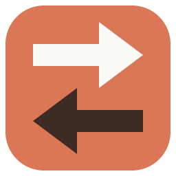
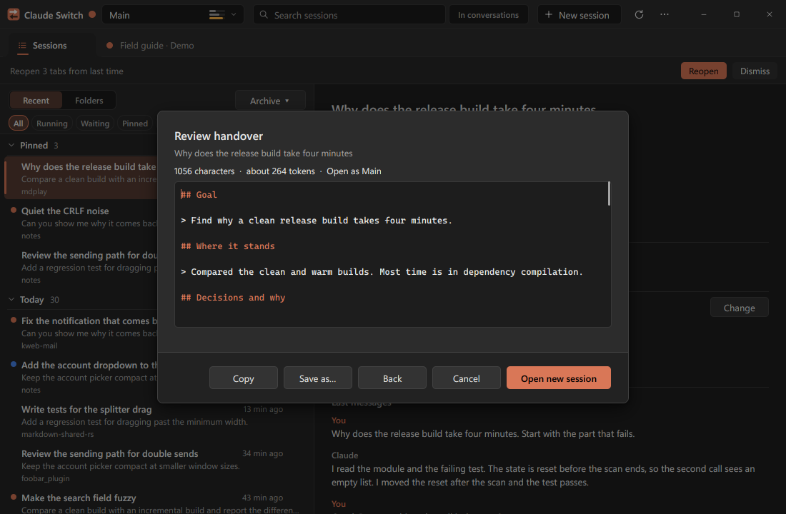

<div align="center">



# Claude Switch

**Every Claude Code session on your PC, in one window.**<br>
Find any session, open it as any of your accounts, and work with it in a real chat view,
while the CLI keeps running underneath.

[](https://github.com/Kaan88/claude-switch/releases/latest)

[](LICENSE)


[**Download**](https://github.com/Kaan88/claude-switch/releases/latest) ·
[Guide](https://github.com/Kaan88/claude-switch/wiki) ·
[What's new](CHANGELOG.md)


</div>

## Why you'd want it

**🔎 Never lose a session again.** Every CLI and Desktop session on the computer is listed with
its folder, branch, size and last messages. Search titles, prompts and whole conversations; pin,
rename, group by project or thread, hide or archive. With search by meaning on, find a session by
what it was about ("where we fixed push").

**👥 Several accounts, one set of everything.** Each account keeps its own login, while
transcripts, skills, agents, plugins and settings are shared. Open any session as any account,
see each account's usage at a glance, and get a warning before you run out.

**💬 A chat view on top of the real CLI.** Read the conversation as a chat, with quiet tool rows,
pictures, plans and a details panel for tasks, agents, shells, files and outputs. Write in a real
editor with `@` paths, history and quick-command chips. Answer Claude's questions, permission
prompts and menus from cards, and rewind to an earlier prompt. Every key Chat sends is checked
against the terminal screen first, and the CLI keeps running in a drawer underneath.

**🧳 Hand over instead of compacting.** When a session gets long, a model you choose writes an
editable handover. It continues in the same tab, in a new one, as another account, or in OpenCode.
It can also start by itself when the context fills up, or from `/switch-compact` inside Claude Code.

**🛡️ Safe by default.** A session already running is never started twice. Deleting moves files to
the Recycle Bin. Anything that sends your text to a model asks first, and there is no telemetry.

**🖥️ A proper terminal, too.** Tabs for Claude Code, OpenCode and plain shells, with Windows
Terminal mouse behaviour, Shift+Enter for new lines, your own themes, Mica and Acrylic
transparency, and tabs that reopen after a restart.

<div align="center">


</div>

## Get started

1. Download **`claude-switch-setup.exe`** from [Releases](https://github.com/Kaan88/claude-switch/releases/latest)
   and run it. It installs for your Windows user, without administrator rights.
2. Have the [Claude Code CLI](https://docs.claude.com/en/docs/claude-code) installed (the native
   `claude.exe` on `PATH`) and, if you use it, the Claude desktop app.
3. Start Claude Switch. Your existing sessions and login are found on their own; add more accounts
   under **Accounts**.

Want to look around first? `claude-switch --demo` starts it with made-up sessions and accounts.

## Learn more

The [guide](https://github.com/Kaan88/claude-switch/wiki) covers everything in detail:

| | |
| --- | --- |
| [Sessions](https://github.com/Kaan88/claude-switch/wiki/Sessions) | Search, filters, grouping, pins, archive, delete, search by meaning |
| [Chat view](https://github.com/Kaan88/claude-switch/wiki/Chat-view) | The composer, cards, rewind, the details panel |
| [Handover and compact](https://github.com/Kaan88/claude-switch/wiki/Handover-and-compact) | Handovers, automatic handover, `/switch-compact`, the command line |
| [Terminal tabs](https://github.com/Kaan88/claude-switch/wiki/Terminal-tabs) | Tabs, mouse, OpenCode tabs, reopening tabs |
| [Accounts and usage](https://github.com/Kaan88/claude-switch/wiki/Accounts-and-usage) | Adding accounts, what is shared, usage warnings |
| [Settings](https://github.com/Kaan88/claude-switch/wiki/Settings) | Every setting, themes, quick commands |
| [Keyboard shortcuts](https://github.com/Kaan88/claude-switch/wiki/Keyboard-shortcuts) | All shortcuts in one place |
| [Troubleshooting](https://github.com/Kaan88/claude-switch/wiki/Troubleshooting) | Known limits and fixes |

### `/switch-compact` inside Claude Code

The installer can add Claude Switch to `PATH` (on by default). Then register this repository's
[plugin marketplace](https://code.claude.com/docs/en/plugins/marketplaces) from the parent folder
of a checkout named `claude-switch`, and install the plugin:

```powershell
claude plugin marketplace add ./claude-switch
claude plugin install switch-handover@kaan88-claude-switch
```

`/switch-handover:switch-compact [agent:<name>] [what to keep]` then hands the session over in the
background. Claude Switch shows the continued session, or why it failed, in its own window. You
have to approve the summary model's provider once in Claude Switch first.

## Privacy

Claude Switch has no telemetry. It talks to the network only when you ask:

- **Usage figures** (Settings → Usage, on by default): reads each account's CLI login token and
  sends it only to Anthropic over HTTPS to ask for subscription usage. The figures are cached, the
  token is not. The endpoint is undocumented and may stop working.
- **Handovers, Suggest names and search by meaning** send conversation excerpts to the model you
  choose, only after you confirm. The guide says exactly what each one sends.

Claude Code, Claude Desktop and OpenCode use their own network connections when you run them.

## Build from source

Install stable Rust with the MSVC toolchain (`x86_64-pc-windows-msvc`), Visual Studio Build Tools
with **Desktop development with C++**, and a Windows SDK with `rc.exe`. Then:

```powershell
cargo build --release --locked -p claude-switch
```

The executable is `target\release\claude-switch.exe`. The
[markdown-shared-rs](https://github.com/Kaan88/markdown-shared-rs) toolkit is fetched by Cargo.
`claude-switch --help` lists all options. [DESIGN.md](docs/DESIGN.md) explains how it works, and
[CONTRIBUTING.md](CONTRIBUTING.md) explains how to help.

## Licence

[MIT](LICENSE). [Third-party notices](THIRD-PARTY-NOTICES) are installed beside the executable and
published with each release.

Claude Switch is an unofficial tool, early software and Windows-only. It is not made by or
affiliated with Anthropic. "Claude" is a trademark of Anthropic.
